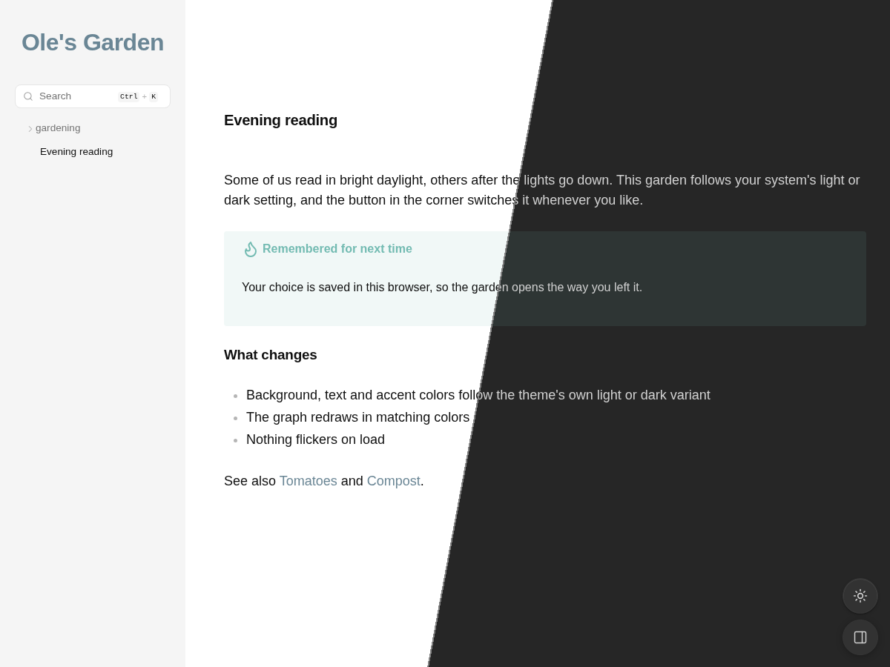

# Light/Dark Mode

Lets visitors read your garden in light or dark mode.

- Follows the visitor's system color scheme (`prefers-color-scheme`) until they pick a mode, and keeps following it live if they change it.
- Adds a sun/moon button to the bottom-right corner. The choice is remembered in the browser and synced across open tabs.
- No flash of the wrong theme on load: the mode is resolved in `<head>`, before anything paints.
- Gives the template's default theme a proper light mode, since it only ships dark colors.
- Only offers the toggle when your theme ships both modes. Themes with a single mode keep rendering exactly as before.
- Redraws the graph in the new colors when the mode changes.

A plugin for [Digital Garden](https://github.com/oleeskild/digitalgarden) sites.

## Install

Paste this repo's URL into **Settings → Digital Garden → Plugins → Install from GitHub** in Obsidian, or copy this folder into `src/plugins/light-dark-mode/` in your garden repo.

The garden's **Base theme** setting (`BASE_THEME`) is the starting mode when the visitor's system has no preference, or when *Follow system color scheme* is off.

## Settings

| Key | Setting | Default |
| --- | --- | --- |
| `followSystem` | Follow system color scheme | `true` |
| `showButton` | Show toggle button (off: only follow the system) | `true` |
| `themeModes` | Theme mode support: `auto`, `both`, `dark`, `light` | `auto` |
| `buttonLabel` | Button label (accessible name and tooltip) | "Toggle light and dark mode" |

`auto` checks the installed theme's CSS for `.theme-light` and `.theme-dark` at build time. It never misses a theme that has both modes, but some dark-only themes still mention `.theme-light`. If the toggle shows up for a theme that looks wrong in light mode, set this to that theme's single mode.

## For other plugins

- `window.gardenLightDarkMode` exposes `get()`, `set("light" | "dark")` and `toggle()`.
- Every mode change dispatches `dg:theme-change` on `document`, with `detail.theme` and `detail.mode` set to the new mode.
- `<html>` carries `data-color-mode="light" | "dark"`.

Don't combine this with another plugin that switches modes, such as the dark mode switch in *Appearance & Reading*. Both would try to set the body's theme class.

## Development

`npm test` runs the unit tests for theme mode detection (Node 22+, no dependencies).
