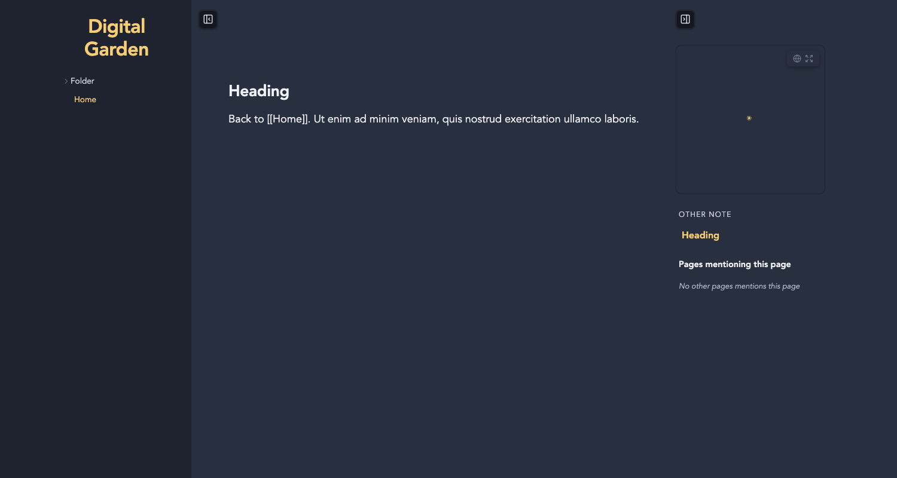

# Sidebar Controls

A [Digital Garden](https://github.com/oleeskild/digitalgarden) plugin that adds buttons for collapsing the file tree and the right sidebar (graph, table of contents, backlinks), so readers can focus on the note. It can also push the right sidebar to the right edge of the window.

- The file tree toggle appears on screens wider than 1000px. Below that, the file tree is already a slide-out menu.
- The right sidebar toggle appears on screens wider than 1400px. Below that, the sidebar is already the bottom-sheet page panel.
- Each reader's choice is saved in their browser and applied before the page renders, so collapsed panels don't flash open.

## Settings

| Setting | Default | Env var | |
|---|---|---|---|
| Toggle file tree | `true` | `SIDEBAR_CONTROLS_FILE_TREE` | Show the file tree button |
| Toggle right sidebar | `true` | `SIDEBAR_CONTROLS_RIGHT` | Show the right sidebar button |
| Button position | `corners` | `SIDEBAR_CONTROLS_POSITION` | `corners`: at the top, next to each panel. `floating`: in the bottom-right floating button stack |
| Right sidebar position | `content` | `SIDEBAR_CONTROLS_SIDEBAR_POSITION` | `content`: next to the note (the template default). `edge`: against the right edge of the window. Wider than 1400px only |
| Remember state | `true` | `SIDEBAR_CONTROLS_REMEMBER` | Keep panels collapsed across pages and visits |

## Install

Paste this repo's URL into your garden's plugin installer, or copy this directory to `src/plugins/sidebar-controls/`.
